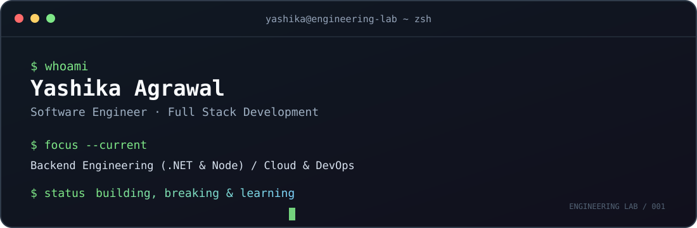
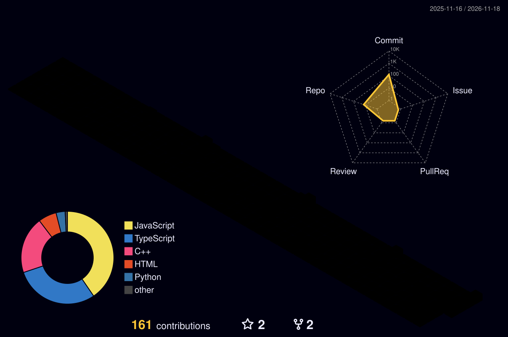

<div align="center">

<!-- Animated Storytelling Terminal Header -->


<p align="center">
  
</p>

**Software Engineer · Full Stack Development**

*I build full-stack web applications, explore how systems work under the hood, and turn what I learn into experiments.*

[](https://github.com/Yashika-Agrawal)
[](mailto:yashikayash2002@gmail.com)

</div>

---

## `~/lab/live-pulse`

<!-- LAB:START -->
| Area | Current Focus / Live Pulse |
|---|---|
| 🚀 **Building** | Pollify (Full-stack real-time polling application) |
| 🔍 **Exploring** | Full-Stack Web Development (.NET / React / Node.js) · Linux Internals & DevOps Automation |
| 🧪 **Latest Experiment** | [Local Linux VMs & SSH key authentication with Multipass](https://github.com/Yashika-Agrawal/Engineering-playground/blob/main/Devops/multipass.md) |
| 📝 **Engineering Note** | [CI/CD Pipeline Automation: Builds, Triggers & Runners](https://github.com/Yashika-Agrawal/Engineering-playground/blob/main/Devops/Ci-Cd/intro-to-ci-cd.md) |
| 💡 **Today I Learned** | [Why SSH prints host key authenticity warning on first connect (Host verification vs client key pairs)](https://github.com/Yashika-Agrawal/Engineering-playground/blob/main/Devops/multipass.md) |
<!-- LAB:END -->

---

## `~/playground-matrix`

> A clickable constellation of hands-on experiments from [`Engineering-playground`](https://github.com/Yashika-Agrawal/Engineering-playground). Click any link to jump straight into the notes:

| Domain | Focus Areas & Hands-On Experiments | Direct Links |
|:---|:---|:---|
| 🐧 **DevOps & Linux** | Local Ubuntu VMs, Multipass, SSH port 22 security groups, host key verification, firewall rules | [`multipass.md`](https://github.com/Yashika-Agrawal/Engineering-playground/blob/main/Devops/multipass.md) |
| 🔄 **CI/CD Automation** | Pipeline architecture, automated build/test gates, GitHub Actions runner isolation | [`intro-to-ci-cd.md`](https://github.com/Yashika-Agrawal/Engineering-playground/blob/main/Devops/Ci-Cd/intro-to-ci-cd.md) |
| 🌐 **Full-Stack Applications** | Real-time state synchronization, WebSocket event lifecycles, full-stack data flow | [`pollify`](https://github.com/Yashika-Agrawal/pollify) · [`live-tracker`](https://github.com/Yashika-Agrawal/live-tracker) |
| 🛠️ **System Fundamentals** | Linux daemons, system services, networking basics, client-server architecture | [`intro-to-devops.md`](https://github.com/Yashika-Agrawal/Engineering-playground/blob/main/Devops/intro-to-devops.md) |

---

## `~/projects`

<div align="center">

| Project | What I Built | Stack |
|---|---|---|
| [**Pollify**](https://github.com/Yashika-Agrawal/pollify) | Real-time polling web application with live voting results and instant state synchronization across clients. | React · Node.js · PostgreSQL · Prisma · Socket.IO |
| [**Live Tracker**](https://github.com/Yashika-Agrawal/live-tracker) | Real-time vehicle location streaming on interactive maps with live coordinate broadcast. | Express · Socket.IO · Docker · Leaflet |

</div>

<br/>

### 🛠️ Full-Stack Architecture Deep-Dive
*(Click to expand the technical flow)*

<details open>
<summary><b>🔍 View: Pollify Full-Stack Architecture (Real-Time State Sync)</b></summary>
<br/>

```text
[ React + Tailwind Frontend ]
         │
         │  (1) Cast Vote / Create Poll
         ▼
[ Express.js + Node.js API Gateway ]
         │
         ├──► (2) Persist Vote ──► [ Prisma ORM ] ──► [ PostgreSQL ]
         │
         │    (3) Broadcast Live Tally (Event Emit)
         ▼
[ Socket.IO Real-Time Server ]
         │
         ▼
[ All Connected Client UIs Updated Instantly ]
```

* **Core Focus:** Ensuring database persistence through Prisma transactions while broadcasting live vote aggregates to connected clients via WebSockets with minimal latency.

</details>

---

## `~/toolbox`

| Layer | Technologies & Tools |
|---|---|
| **Frontend** | React · JavaScript · TypeScript · Tailwind CSS · HTML5 / CSS3 |
| **Backend & APIs** | C# · .NET · ASP.NET Core · Node.js · Express · REST APIs |
| **Data & Databases** | PostgreSQL · SQL · MongoDB · Prisma ORM |
| **Infra & DevOps** | Docker · Linux · Multipass · Git · GitHub Actions · CI/CD · AWS |

---

## `~/contributions`

<div align="center">

<!-- 3D Isometric Contribution Skyline (Falls back to snake if pending first run) -->
<picture>
  <source media="(prefers-color-scheme: dark)" srcset="profile-3d-contrib/profile-night-rainbow.svg">
  
</picture>


</div>

---

<div align="center">

**Always learning. Always building. Always curious.**

`console.log("Thanks for stopping by 👋");`

</div>
