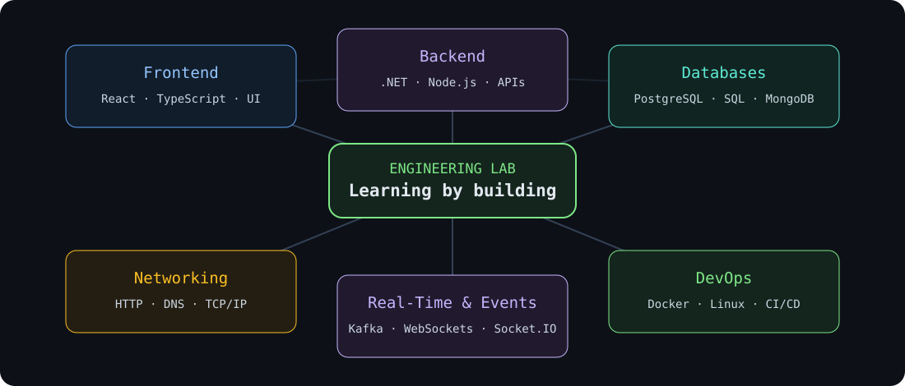

<div align="center">


<p align="center">
  
</p>

**Software Engineer · Full Stack Development · Backend Engineering**

*I build web applications, explore how systems work under the hood, and turn what I learn into experiments.*

[](https://github.com/Yashika-Agrawal)
[](mailto:yashikayash2002@gmail.com)

</div>

---

## `~/lab/status`

<!-- LAB:START -->
| Area | Current focus |
|---|---|
| **Building** | RailRush (.NET & PostgreSQL) |
| **Exploring** | Backend engineering (.NET / Node.js) · DevOps & Linux internals |
| **Recent experiment** | [Local Linux VMs & networking with Multipass](https://github.com/Yashika-Agrawal/Engineering-playground) |
| **Latest note** | [CI/CD Pipeline automation & build flows](https://github.com/Yashika-Agrawal/Engineering-playground) |
<!-- LAB:END -->

> This section is generated from [`data/lab.json`](data/lab.json). Update that file when your focus changes.

## `~/projects`

<div align="center">

| Project | What I'm working on |
|---|---|
| **RailRush** | A railway reservation system used to explore database modelling, transaction flows and backend architecture with .NET & PostgreSQL. |
| [**Pollify**](https://github.com/Yashika-Agrawal/pollify) | Real-time polling application built with React, Node.js, PostgreSQL, Prisma and Socket.IO. |
| [**Live Tracker**](https://github.com/Yashika-Agrawal/live-tracker) | Real-time location tracking with Express, Socket.IO, Kafka, Docker and Leaflet. |

</div>

*Project descriptions are intentionally concise. Repository link for RailRush will be added once ready to share.*

### 🛠️ Interactive Architecture Deep-Dives
*(Click to expand the technical breakdown of each system)*

<details>
<summary><b>🔍 View: Live Tracker Architecture (Event-Driven Streaming)</b></summary>
<br/>

```text
[ Leaflet Client (Browser) ]
         │
         │  (WebSockets / Socket.IO)
         ▼
[ Express.js Gateway ]
         │
         │  (Producer Event)
         ▼
[ Apache Kafka Cluster ] ──► [ Topic: vehicle-coordinates ]
         │
         │  (Consumer Stream)
         ▼
[ Dockerized Service Worker ] ──► Real-Time Broadcast & Spatial Processing
```

* **Core Focus:** Decoupled telemetry ingestion from client broadcasts using Kafka to prevent WebSocket gateway bottlenecks during coordinate bursts.

</details>

<details>
<summary><b>🔍 View: RailRush Reservation & Concurrency Flow</b></summary>
<br/>

```text
[ Booking Request ] ──► [ ASP.NET Core Web API ] ──► [ EF Core Transaction ]
                                                              │
                                                              ▼
                                                    [ Row-Level DB Lock ]
                                                    (Prevents Double Booking)
                                                              │
                                                              ▼
                                                    [ PostgreSQL Commit ]
```

* **Core Focus:** Exploring ACID transaction isolation levels and concurrency control to handle simultaneous ticket bookings safely under high contention.

</details>

## `~/engineering-map`

A map of the topics I'm exploring. Each node can grow into an experiment, note or project.

<div align="center">

</div>

## `~/takeaways`

<details open>
<summary><b>💡 Under the Hood: Engineering Insights & Lessons</b></summary>
<br/>

- **Concurrency & Transactions (.NET / SQL):** High-traffic booking logic cannot rely on application-level locks alone when scaling horizontally; handling isolation levels (`SELECT FOR UPDATE` / row-level locks) directly in PostgreSQL ensures zero race conditions.
- **Event Streaming (Kafka):** WebSockets are great for real-time client communication, but adding a Kafka message queue in between isolates ingestion spikes and protects backend services from crashing.
- **Environment Isolation (Linux & Multipass):** Running local Ubuntu micro-instances using Multipass provides true kernel-level isolation, making it much more representative of production Linux servers than standard containers.

</details>

## `~/toolbox`

| Layer | Technologies & Tools |
|---|---|
| **Backend & APIs** | C# · .NET · ASP.NET Core · Node.js · Express · REST APIs |
| **Data & Messaging** | PostgreSQL · SQL · MongoDB · Prisma · Apache Kafka |
| **Frontend** | React · JavaScript · TypeScript · Tailwind CSS |
| **Infra & DevOps** | Docker · Linux · Multipass · Git · GitHub Actions · CI/CD · AWS |

## `~/contributions`

<div align="center">

</div>

---

<div align="center">

**Always learning. Always building. Always curious.**

`console.log("Thanks for stopping by 👋");`

</div>
